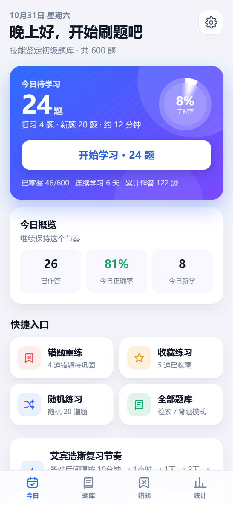
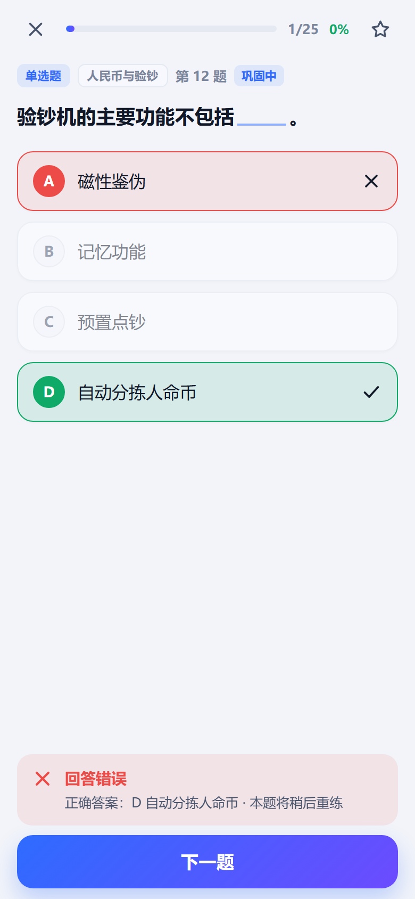
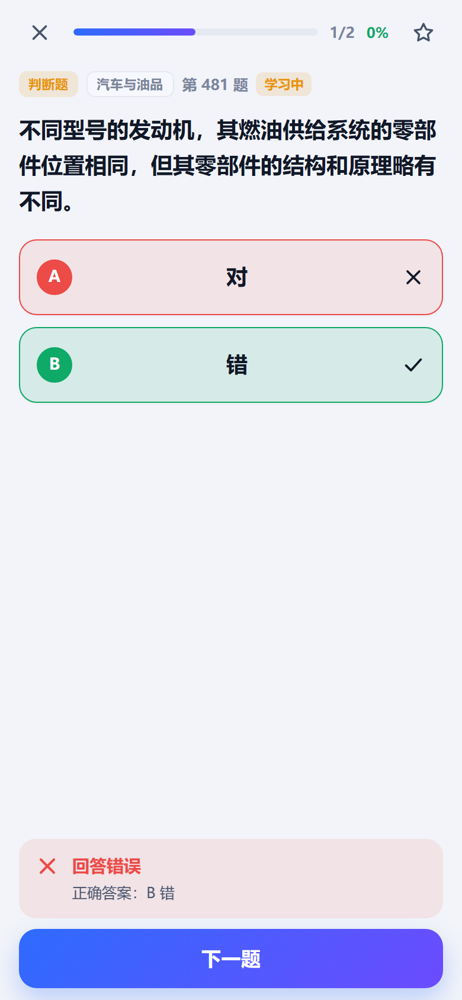
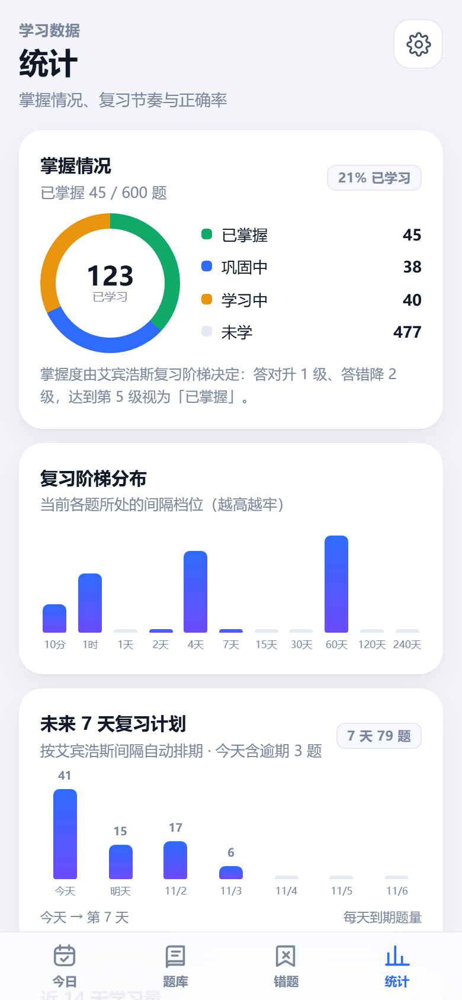
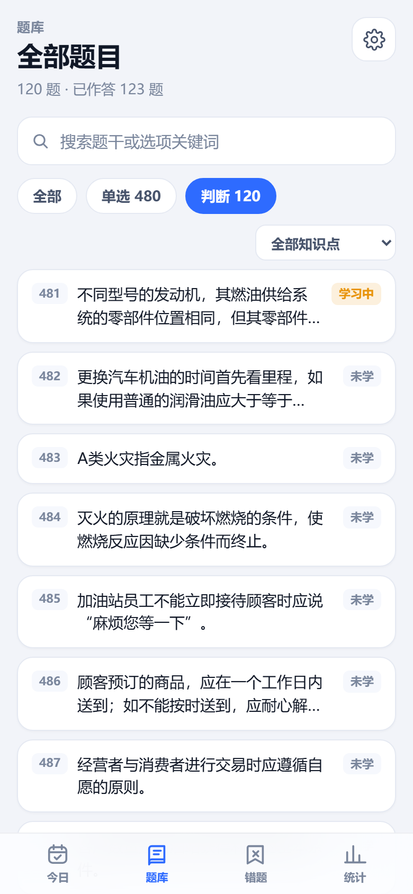
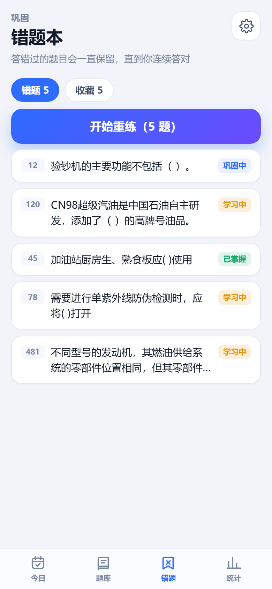
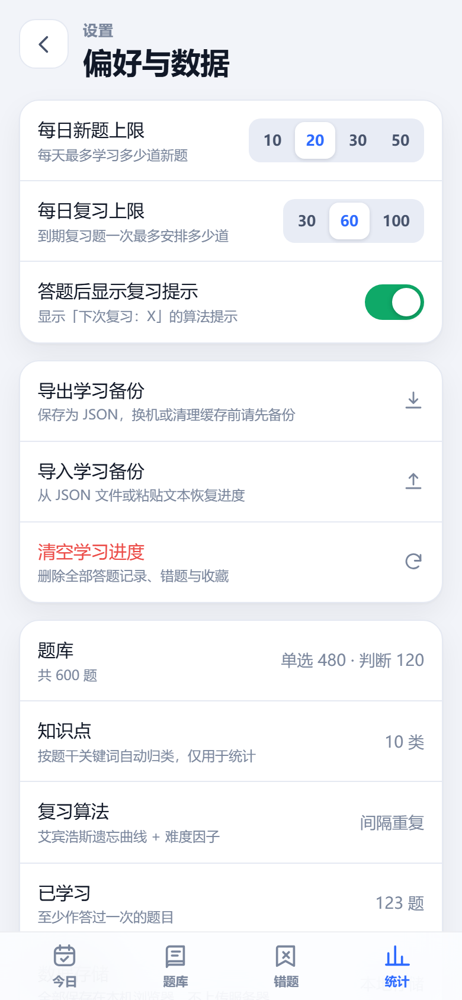
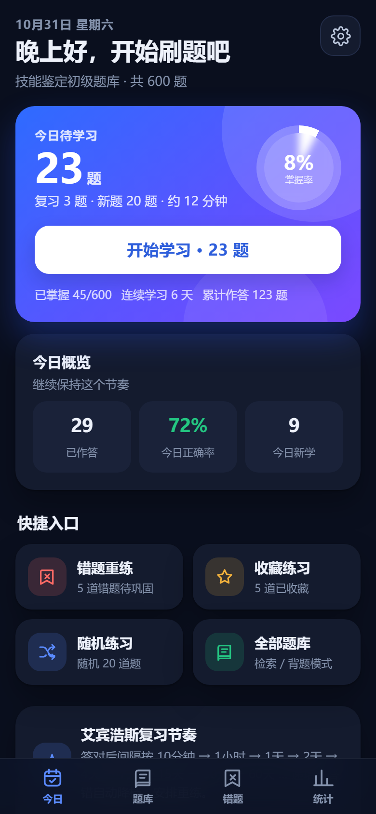

# 技能鉴定刷题 · iPhone 刷题 PWA

基于《3_技能鉴定初级题库（2018年新版）.docx》开发的 **iPhone 优先、完全离线** 的刷题应用。
核心是 **艾宾浩斯遗忘曲线间隔重复算法**：根据每道题答对 / 答错，动态调整下次复习时间，把时间花在最该复习的题上。

> 形态说明：这是 PWA（渐进式 Web App），不是 App Store 应用。用 iPhone 的 Safari 打开后「添加到主屏幕」，
> 就会以全屏、无地址栏的方式运行，体验与原生 App 基本一致，**无需 Mac / Xcode / 开发者账号，也不用上架审核**。
> 数据全部保存在本机，不上传任何服务器。

---

## 功能一览

| 模块 | 说明 |
|---|---|
| 今日计划 | 每天自动排出「到期复习题 + 新题」，显示掌握率、连续打卡、今日正确率 |
| 答题判分 | 单选 A–D、判断固定 **A = 对 / B = 错**；点选即判分，答错高亮正确答案并排到本次末尾重练 |
| 艾宾浩斯复习 | 答对升档（10 分钟 → 1 小时 → 1 天 → 2 天 → 4 天 → 7 天 → 15 天 → 30 天 → 60 天 → 120 天 → 240 天），答错降 2 档立即重练 |
| 掌握度 | 未学 / 学习中 / 巩固中 / 已掌握 四档，题库列表逐题可见 |
| 错题本 | 自动收集答错过的题，按错误次数排序，一键重练 |
| 收藏 | 答题页 / 题库页星标收藏，单独成组练习 |
| 题库 | 600 题全量列表，支持关键词搜索、单选/判断筛选、知识点筛选、展开看答案背题、单题练习 |
| 统计 | 掌握分布、复习阶梯分布、**未来 7 天复习计划**、近 14 天学习量、知识点正确率、最近学习记录 |
| 设置 | 每日新题上限、每日复习上限、算法提示开关、导出 / 导入备份、清空进度 |
| 离线 | Service Worker 缓存全部资源，断网也能正常刷题 |
| 适配 | iPhone 安全区、深色模式、44px+ 点击区域、无横向滚动 |

---

## 界面预览（iPhone 390 × 844）

| 今日计划 | 答题判分 | 判断题（A=对/B=错） | 学习统计 |
|---|---|---|---|
|  |  |  |  |

| 题库（背题模式） | 错题本 | 设置 | 深色模式 |
|---|---|---|---|
|  |  |  |  |

> 截图为演示数据（`node tests/demo_shots.mjs` 生成，可复现）。

---

## 快速开始

### 方式 A：单文件版（最省事，直接发到 iPhone）

1. 在电脑上找到 `dist/技能鉴定刷题.html`（约 1.0 MB，已内联全部代码、题库、图标）；
2. 用 AirDrop / 微信文件传输助手 / iCloud 云盘把它发到 iPhone；
3. iPhone 用 **Safari** 打开该文件即可开始刷题（无需网络）。
4. 想变成「桌面 App」：把这个 HTML 放到任意 HTTPS 静态托管上，再用 Safari 打开 → 分享 → **添加到主屏幕**。

> 单文件版适合临时使用；长期使用推荐方式 B，才能获得「主屏幕全屏 + 离线缓存 + 自动更新」。

### 方式 B：部署为 PWA（推荐，一次部署长期用）

把整个项目文件夹（`index.html`、`styles/`、`src/`、`icons/`、`manifest.webmanifest`、`sw.js`）上传到任意静态托管：

- **Netlify Drop**：<https://app.netlify.com/drop> 拖入文件夹，立刻得到 HTTPS 网址；
- **GitHub Pages / Vercel / Cloudflare Pages**：推送到仓库后开启 Pages 即可；
- 用自己的服务器 / 宝塔 / Nginx：把文件夹放到站点目录。

然后在 **iPhone 的 Safari** 中打开该网址 →

1. 点底部的「分享」按钮；
2. 选择「**添加到主屏幕**」；
3. 桌面出现「刷题」图标，双击打开即全屏运行。

> ⚠️ 必须是 HTTPS（或 localhost）Service Worker 才会生效，离线能力才可用。
> 用普通 http 局域网地址打开也能刷题，但重启后不会离线缓存。

### 方式 C：本机预览 / 开发调试

```bash
# 任选一种静态服务器（在本项目根目录执行）
python -m http.server 8080
# 或
npx serve -l 8080
```

浏览器打开 <http://127.0.0.1:8080/index.html>。
用 Chrome DevTools 的设备模拟选 iPhone 14 Pro（390 × 844）即可看到手机效果。
本机调试建议用 `localhost`，Service Worker 会正常注册。

---

## 艾宾浩斯复习算法

每道题是一张「记忆卡片」，记录：复习档位 `level`（0–10）、难度因子 `ease`（1.3–2.8）、连续答对次数、
答错次数、下次到期时间 `due`、最近 20 次作答历史。

| 复习档位 | 0 | 1 | 2 | 3 | 4 | 5 | 6 | 7 | 8 | 9 | 10 |
|---|---|---|---|---|---|---|---|---|---|---|---|
| 基础间隔 | 10 分钟 | 1 小时 | 1 天 | 2 天 | 4 天 | 7 天 | 15 天 | 30 天 | 60 天 | 120 天 | 240 天 |

- **答对**：升 1 档，`ease` 微增（连续答对涨得更快），实际间隔 = 基础间隔 × 难度系数（0.4–1.15），
  越熟练复习间隔越长；
- **答错**：降 2 档，`ease` 减 0.2，下次复习立刻变密；本次练习中还会**排到队尾再练一次**；
- **掌握度**：档位 ≥ 5 记为「已掌握」，2–4「巩固中」，0–1「学习中」；
- **今日计划** = 已到期复习题（按到期时间升序）+ 新题（每日上限内），每天打开 App 就知道该刷哪些题。

统计页的「复习阶梯分布」和「未来 7 天复习计划」就是这套排期的可视化。

---

## 题库

- 来自 `3_技能鉴定初级题库（2018年新版）.docx`：**480 道单选 + 120 道判断 = 600 题**，题目原文未改写；
- 判断题统一固定选项 **A = 对，B = 错**；
- 每题标注 **知识点**（加油卡业务、加油机与设备、人民币与验钞、便利店运营、客户服务、安全与消防、
  汽车与油品、财务与发票、站务与现场管理、其他）——由题干关键词自动归类，仅用于筛选与统计；
- 解析与校验脚本：`tools/parse_bank.py`，生成 `data/questions.json` 与 `src/questions.js`；
  已校验 600 题答案均在选项内、无缺答案。

重新生成题库：

```bash
python tools/parse_bank.py
```

---

## 项目结构

```
├── index.html                 应用入口（PWA 壳）
├── manifest.webmanifest       PWA 清单（名称 / 图标 / 全屏）
├── sw.js                      Service Worker：离线缓存
├── styles/app.css             iPhone 优先样式（含深色模式）
├── src/
│   ├── questions.js           题库（自动生成，globalThis.QUESTION_BANK）
│   ├── srs.js                 艾宾浩斯间隔重复算法（纯函数，可单测）
│   ├── store.js               localStorage 数据层（卡片 / 统计 / 备份）
│   └── app.js                 界面与交互（今日 / 题库 / 错题 / 统计 / 设置 / 答题 / 结算）
├── icons/                     应用图标（1024 / 512 / 192 / apple-touch-icon / favicon）
├── data/questions.json        题库结构化数据
├── docs/SPEC.md               技术规格与模块契约
├── docs/部署与安装.md         更详细的部署 / 安装 / FAQ
├── docs/screenshots/          界面截图（iPhone 390×844）
├── dist/技能鉴定刷题.html      单文件版（内联全部资源）
├── tools/
│   ├── parse_bank.py          docx → JSON/JS 题库解析
│   ├── gen_icons.py           生成全部图标
│   └── build_single.py        打包单文件版
└── tests/
    ├── srs.test.js            算法单元测试（24）
    ├── store.test.js          存储单元测试（19）
    ├── e2e.mjs                无头 Chrome 端到端测试（43 项）
    ├── e2e-dist.mjs           单文件版 file:// 验证（12 项）
    └── demo_shots.mjs         生成本文档用的界面截图
```

---

## 开发与验证

```bash
# 单元测试（Node 22+）
node tests/srs.test.js      # PASS srs: 24 tests, 0 failed
node tests/store.test.js    # PASS store: 19 tests, 0 failed

# 端到端测试（需先在本机 8765 端口起静态服务器 + 安装 Chrome）
python -m http.server 8765 --bind 127.0.0.1   # 另一个终端
node tests/e2e.mjs          # 43/43 passed，截图输出到 tools/shots/
node tests/e2e-dist.mjs     # 12/12 passed，验证 dist 单文件 file:// 可用
```

E2E 覆盖：iPhone 390×844 视口布局与无横向溢出（另测 375/430/320 三种宽度）、答题判分、错题重练、
判断题 A/B、搜索筛选、知识点专项、导出 / 导入备份、清空进度、深色模式、刷新后数据持久化、
**断网刷新仍可用**、无 JS 运行时错误。单文件测试覆盖：全部资源内联、无外部请求、file:// 下 localStorage 可用。

### 修改代码后记得

1. 改了 `index.html / styles/*.css / src/*.js / icons/*` → 把 `sw.js` 里的 `CACHE_VERSION` 改成新值（如 `skillquiz-v20261031`），
   否则已安装用户会一直用旧缓存；
2. 重新生成单文件版：`python tools/build_single.py --strict`。

---

## 数据与隐私

- 所有学习记录存在浏览器 `localStorage`（键名 `skillquiz.v1`），**不上传、不联网**；
- 清理 Safari 网站数据 / 卸载主屏幕图标会丢失进度，**建议定期「设置 → 导出学习备份」**，换机时用导入恢复；
- 数据可在其他浏览器 / 电脑上导入继续使用（同一份 JSON 备份）。

## 常见问题

- **图标是旧版 / 页面没更新？** 修改 `sw.js` 的 `CACHE_VERSION` 后重新部署，Safari 里下拉刷新两次或在
  「设置 → Safari → 高级 → 网站数据」清除本站数据后重开（会丢进度，先导出备份）。
- **添加到主屏幕后打不开 / 白屏？** 确认部署网址是 HTTPS，且 `index.html`、`src/`、`styles/`、`icons/` 都上传完整（大小写敏感）。
- **没有 Mac 能用吗？** 能。本项目不需要 Xcode，PWA 由 Safari 直接运行。
- **能上架 App Store 吗？** 这个交付形态不需要；若要做原生上架版本，可基于同一套 JSON 题库与算法再封装 SwiftUI。

---

**版本**：1.0.0 ｜ 题库：600 题（2018 年新版·技能鉴定初级） ｜ 算法：艾宾浩斯遗忘曲线 + 难度因子 ｜ 形态：iPhone PWA
